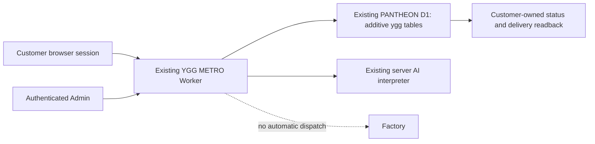

# Chat identity and request workflow — implementation evidence

**BUILT / TESTED locally. Production verification is BLOCKED until owner-approved migration/configuration/deployment.** No production deployment, merge, live charge, Factory job, secret modification or resource creation was performed.

## Source and earlier PR comparison

Started from current `main` 6fc81162bff15d6d61e84d1f06f2b86284cdd92c on isolated branch `feat/chat-identity-brief-workflow-20261019`.

- PANTHEON PR #11 supplied the ownership/CAS/idempotency patterns and review lessons. Its older receiver/deployment modules were not copied or merged over current PANTHEON (which now includes LIGHT support).
- Storefront PR #59 is based before current main's OwnerBridge adapter. Its removal of the retired GO Hub binding alone does not satisfy this task. It was not merged or cherry-picked. This branch removes the public customer use of general OwnerBridge authority and implements a scoped request store instead.
- WorkHub/PANTHEON/OwnerBridge/Factory identifiers, existing tables and APIs in those systems remain unchanged. Existing `/api/v1/brief/upsert` and `/api/v1/brief/confirm` paths remain authenticated adapters; their request IDs and version-1 brief fields are retained. Callers must bootstrap the new customer session and send same-origin JSON. Ownership cannot be established from caller-supplied clientId or conversationId.

## Behavior

`/client` and `/requests` show the customer-owned persistent request and chat. `/admin/requests` is the authenticated receiving center. Existing storefront/Stripe routes are retained.



The receiving center is the storefront's scoped UI over `ygg_requests`, not an automatic copy into the general WorkHub `tasks` table. `WORK-SPECTRUM-*` identifies the request queue record, not a Factory job or a promise of execution. General OwnerBridge/Factory operations remain outside the public customer capability. Admin reads the complete brief and server transcript here before choosing separately authorized work elsewhere.

- AI-generated text: **AI - GO**, sender type `AI`, sender ID `go`.
- Verified human reply: **Admin**, sender type `ADMIN`, stable actor ID from the server credential mapping.
- Automatic status/error/policy text: **System**, sender type `SYSTEM`, server component ID. Deterministic catalog responses are System, never falsely attributed to AI or a human. Policy text replacing model output also reports System.
- Customer messages: **คุณ**, sender type `CUSTOMER`, server session-principal ID.

Every persisted message includes server timestamp, sender type and ID. Handoff, status, draft and message mutations carry actor/time audit events. The browser never supplies an authoritative sender, actor or timestamp; spoofing is rejected. History/notifications render server labels and text through textContent. Admin login credentials live only in page memory, not localStorage or message bodies.

Drafts persist server-side and can be reopened. Confirmation has a transactional CAS and stable work identity; retry/concurrent confirmation creates one submission event. Sending a request does not invoke AI and remains possible while inference is pending or failed. Admin takeover suppresses in-flight stale AI and future automatic AI replies until authenticated resume. Stale polling cannot change the selected request; slow saves lock brief edits so newer typing is not silently discarded. Lists paginate rather than silently hiding records beyond 100.

Statuses: DRAFT → SUBMITTED → REVIEWING → IN_PROGRESS → DELIVERED → FOLLOW_UP. Public display: บันทึกร่าง → ศูนย์รับงาน → กำลังตรวจสอบ → กำลังดำเนินงาน → ส่งมอบงาน → ติดตามผล. Only authenticated Admin can progress status. DELIVERED requires actual nonempty text-artifact content, persisted with SHA-256 and readable by the same customer; an optional HTTPS reference is supplementary, not independently verified external content. This implementation delivers text artifacts, not a new binary-file upload system.

## Authentication and storage

`REQUESTS_DB` explicitly reuses the existing `pantheon-workhub` D1 resource. It does not create a database. The new `ygg_*` tables are additive and separate from existing WorkHub/Observatory tables. The binding does give this existing storefront Worker D1 access; owner must review that deployment boundary before release.

Customer authentication is an opaque 256-bit token in a Secure/HttpOnly/SameSite=Strict `__Host-ygg-request` cookie. Only its SHA-256 is stored; expiry is 90 days. Another cookie/session receives 404 for a foreign request, including confirmation/overwrite attempts. Cross-site mutation and session bootstrap are rejected. Admin credentials are independently scoped; do NOT reuse WORKHUB_TOKEN, payment credentials or OAuth secrets.

Configure `YGG_ADMIN_CREDENTIALS` as a secret JSON object mapping per-Admin stable IDs to SHA-256 hashes of independently generated high-entropy bearer tokens. Tokens must contain 32–200 ASCII letters/digits/underscore/hyphen; ID uses 1–80 letters/digits/underscore/hyphen. The server derives actor IDs from the verified mapping and compares digests in constant-time loops. Do not commit raw tokens or secret values. Removing a mapping revokes that Admin token. No credentials were provisioned by this task.

**Session scope limitation:** this is browser-session identity, not a newly invented account/login service. Clearing cookies, expiry or changing devices requires an owner-approved recovery/account-linking process; the UI says so. Existing unowned legacy WorkHub tasks cannot safely be claimed by matching a public brief ID. No such automatic claim/migration is performed.

The optional “นำร่างเดิมมาแก้ต่อ” imports only whitelisted draft fields from the existing browser's `yggmetro-spectrumsale-v1` storage into a new owned draft. It neither deletes old storage nor turns unverified historical roles into AI/Admin messages. Legacy conversation data is retained locally without invented server provenance. The catalog guide remains stateless; persistent conversation/history and Admin handoff are in `/client`.

## Reproduce local verification

Node 24.19.0 and Chromium were used. Miniflare is pinned in devDependencies and the existing lockfile. AI provider output and outage are explicit fixtures; no real model inference, payment or external Factory execution is claimed.

```sh
npm ci --no-audit --no-fund
npm test
CHROMIUM_PATH=/usr/bin/chromium npm run test:e2e
mkdir -p .wrangler/identity-e2e
openssl req -x509 -newkey rsa:2048 -nodes \
  -keyout .wrangler/identity-e2e/key.pem \
  -out .wrangler/identity-e2e/cert.pem -days 1 -subj /CN=localhost
npx wrangler deploy --dry-run --outdir .wrangler/identity-e2e/bundle
CHROMIUM_PATH=/usr/bin/chromium npm run test:requests:e2e
```

The local certificate/key and screenshots stay under ignored `.wrangler/`; no production key is used. Browser acceptance runs the actual bundled Worker in local workerd with real D1, via a local HTTPS harness and three separate browser contexts. It exercises draft reload, delayed polling race, AI outage/pending inference, duplicate/concurrent confirmation, customer isolation/spoof rejection, Admin authorization/takeover/reply/resume, status audit and delivered artifact hash/readback. Node SQLite tests additionally force a transaction failure and prove rollback/retry. Existing Stripe SDK tests are simulations, not live payment acceptance.

Evidence: `unit-tests.log`, `storefront-browser.log`, `wrangler-dry-run.log`, `browser-workerd.log`, `browser-workerd-result.json`. The old tests requiring anonymous OwnerBridge list/create access and AI-precheck-dependent submission were replaced by tests for the new authorized behavior; existing intent guards, commerce/Stripe and storefront routing regressions remain.

## Release gates and unverified work

1. Owner reviews shared-D1 binding, per-Admin access and data-retention/recovery policy. Take a verified backup of existing PANTHEON D1 before applying the additive `migrations/0002_request_workflow.sql`. No automatic production migration runs in the Worker.
2. Apply/rehearse the schema in an authorized nonproduction environment, configure independently generated Admin credentials through secure secret management, then approve production deployment separately. This task did not modify PANTHEON production or its Worker code.
3. Verify actual deployed version, customer session/readback, real Admin login, provider response/provenance, handoff and status history. Repeat cross-customer rejection and submission during actual provider outage. Current GREEN evidence is local only; production remains unverified.
4. Reconcile legacy WorkHub tasks with verified customer ownership before exposing them. Preserve existing state and old browser history. Cross-device recovery/login, binary delivery and independent general WorkHub task synchronization are not silently claimed implemented.
5. Keep legacy quote-payment and GO whisper/takeover budget operations closed until their separately approved contracts exist. The new direct request/chat workflow does not depend on them. Stripe and real-money enablement remain separate approval/testing steps.
6. No Factory execution route/button is added. Any later dispatch must use the existing owner-approved scope and evidence procedures.
7. Rollback must preserve new ygg records and their ownership. An older UI/flag is not a reverse data migration. Retain backup/export and provide an authorized read path before reverting application versions; do not drop the additive tables.

## Review

An independent read-only reviewer reproduced and verified fixes for shared AI rate-limit identity, stale polling and slow-save edits; checked CAS/auth/session isolation/provenance; ran the 10 workflow tests and found no remaining reproducible Critical/Important issue in that local scope. The reviewer did not independently certify production or rerun the browser acceptance. No runtime agents/Workers were created.

## Delivery

Draft PR: https://github.com/pureekangraw-ops/yggmetro-web/pull/60

Implementation commit: `7dbc58aa7bc59ff23bcb8cbe4429a1ca97e41b25`. Branch: `feat/chat-identity-brief-workflow-20261019`. Main readback at PR creation remains `6fc81162bff15d6d61e84d1f06f2b86284cdd92c`. Documentation-only follow-up records this delivery; no production action is authorized by PR creation.
